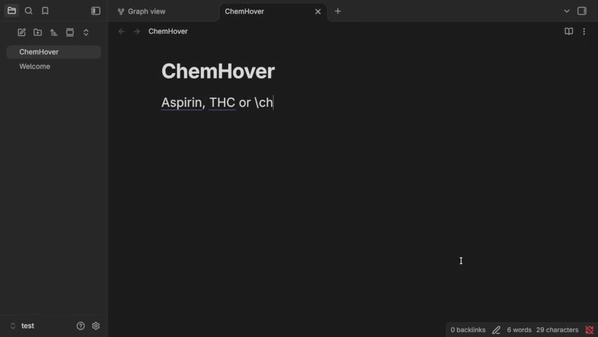
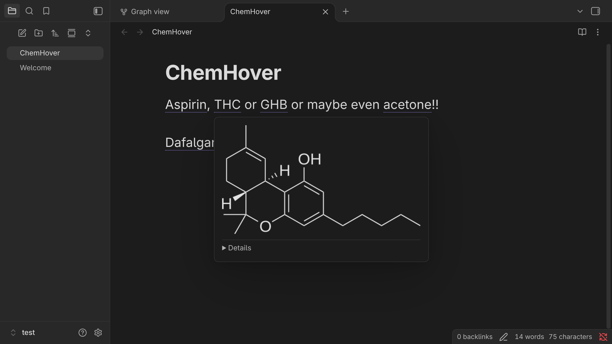
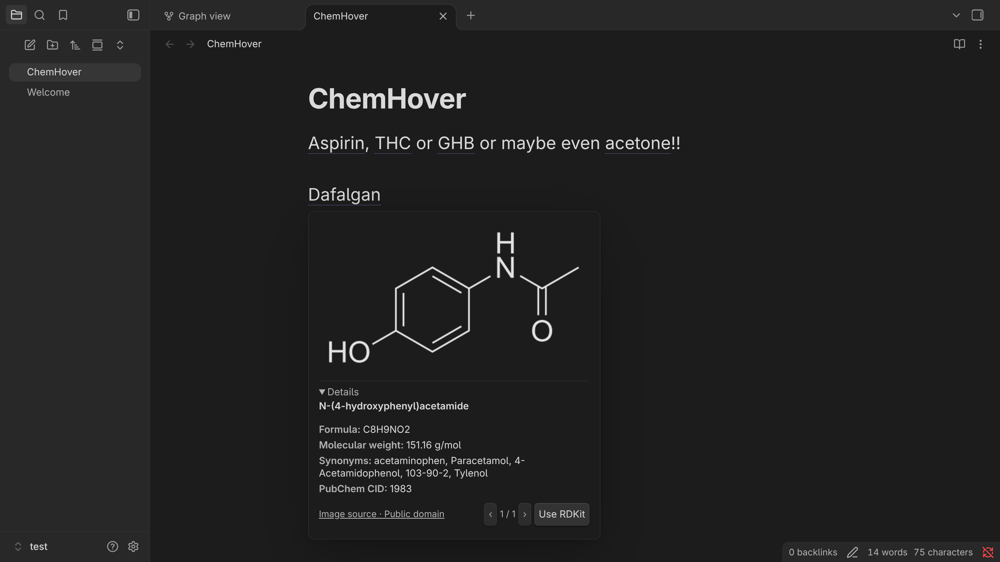

# ChemHover

ChemHover adds chemical structure previews to Obsidian. Mark a chemical name in
your note, then hover over it to see its structure and useful compound details.
It prefers structure images from Wikipedia and can draw a local fallback with
RDKit.

## See it in action

The demo below was recorded in Obsidian. It is trimmed by three seconds at the
beginning and end and sped up 2×.



| Dark theme preview | Expanded details and image controls |
| --- | --- |
|  |  |

## Install

Download `main.js`, `manifest.json`, and `styles.css` from the
[ChemHover 0.1.4 release](https://github.com/tiaguinho-code/ChemHover/releases/tag/0.1.4)
and place them in your vault's plugin folder:

```text
<vault>/.obsidian/plugins/chemhover/
```

Then open **Settings → Community plugins**, enable community plugins if
prompted, and enable **ChemHover** in the installed plugins list. Restart
Obsidian if the plugin does not appear.

The RDKit WebAssembly runtime is embedded in `main.js`; you do not need to
download a separate `.wasm` file.

## Use

Use `\ch` followed by a single-word name:

```text
\ch Aspirin
```

Wrap names containing spaces in braces:

```text
\ch{Acetylsalicylic acid}
```

The Markdown source stays unchanged. ChemHover recognizes marked names in
Reading view and Live Preview, but ignores code spans, code blocks, and math.

When you hover over a marked name, ChemHover looks it up and displays a
structure preview. Click a marked name to keep its preview open after moving
the pointer away; click elsewhere to dismiss it. This also makes previews
easier to use on touchscreens. If PubChem returns multiple matches, choose the
intended compound from the selection list; that choice is saved for later
lookups.

The preview can include:

- A Wikipedia structure image when a suitable image is available.
- A **Details** panel with the compound name, formula, molecular weight,
  synonyms, and PubChem CID.
- Image source and license information, plus controls to cycle through
  available images. Use the buttons or the left/right arrow keys while the
  preview is hovered.
- **Use RDKit** and **Use Wikipedia** controls to choose the preferred artwork
  for a compound. ChemHover remembers that choice.

If a Wikipedia image is unavailable or fails to load, ChemHover renders the
structure locally with RDKit.

## Cache and connectivity

ChemHover uses PubChem to resolve chemical names and Wikipedia to look up
structure images, so the first lookup and image search require an internet
connection. Resolved compound data is stored with the plugin's Obsidian data.
Cached compounds can still be rendered offline with RDKit; Wikipedia images
may not be available without a connection.

Use these commands from Obsidian's command palette:

- **Refresh chemical cache from PubChem** updates saved compound records.
- **Clear chemical cache** removes cached records and name aliases.

Unsuccessful name lookups are cached for 24 hours. Transient network errors
are not cached.

## Troubleshooting

- **No preview appears:** check the `\ch` syntax and hover over the marked
  name. Names inside code or math are intentionally ignored.
- **No PubChem match:** check the spelling or try a more common chemical name.
  Close the selection list without choosing to cancel that lookup.
- **No structure image:** ChemHover falls back to local RDKit rendering when
  Wikipedia has no suitable image or the image cannot be loaded.
- **Preview does not work offline:** the chemical must have been resolved and
  cached previously. The first PubChem lookup needs a network connection.
- **Manual install or update:** make sure `main.js`, `manifest.json`, and
  `styles.css` are all in the `chemhover` plugin folder, then reload Obsidian.
  No separate RDKit wasm file is required.

## Development

Requires Node.js and npm:

```sh
npm ci
npm run typecheck
npm run build
```

`npm run dev` watches the source and rebuilds `main.js` on changes. For local
testing, copy `manifest.json`, `main.js`, and `styles.css` to
`<vault>/.obsidian/plugins/chemhover/`, then enable or reload the plugin.
The build embeds a gzip-compressed RDKit MinimalLib WebAssembly module in
`main.js`. CodeMirror and Lezer packages remain external so the editor
extension uses Obsidian's runtime instances.

### Project layout

- `src/parser/` recognizes the explicit `\ch` syntax.
- `src/pubchem/` resolves chemical names and handles multiple matches.
- `src/wikipedia/` looks up structure images and their source pages.
- `src/database/` stores chemical records, aliases, and temporary failed
  lookups using Obsidian plugin data storage.
- `src/renderer/` uses RDKit MinimalLib to generate and cache fallback SVGs.
- `src/hover/` displays the structure preview and compound details.

## License

ChemHover is licensed under GPL-3.0-only. The bundled RDKit MinimalLib
WebAssembly module is under the BSD 3-Clause License; see
[`LICENSES/RDKit.txt`](LICENSES/RDKit.txt).
